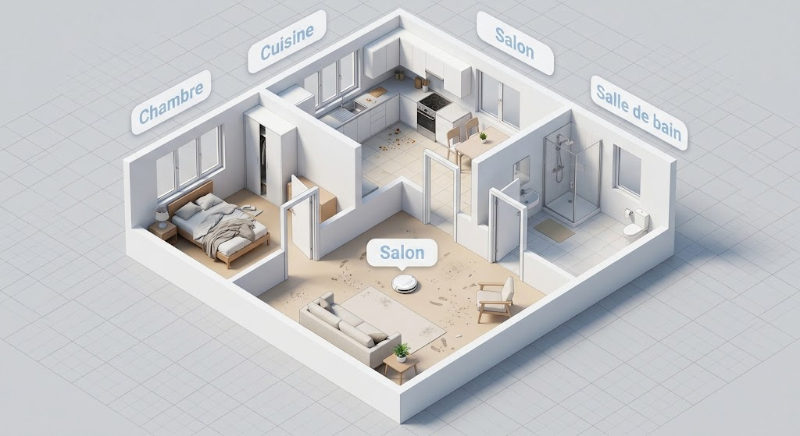

# TP Planification IA — Robot Aspirateur

**Sujet 2** — Modélisation STRIPS/PDDL d'un robot aspirateur qui nettoie
plusieurs pièces d'un logement, testée avec Fast Downward et vérifiée en Python.

## Auteurs
- Groupe N — M1 (Semestre 2)
- KIMBUNGU SIMEON GEDEON
- TANDU KIKALANGA NATHAN
- LABEM KAPINGA KETSIA
- KALEMBU MASIRIKA CONSTATIN
- LUNGA KABITA SUPREME

---

## Arborescence du projet

```
aspirateur/
├── pddl/                    → fichiers de modélisation PDDL
│   ├── domain.pddl
│   ├── problem.pddl
│   ├── problem2.pddl
│   └── problem3.pddl
├── plans/                   → plans produits par Fast Downward
│   ├── plan1.txt
│   ├── plan2.txt
│   └── plan3.txt
├── src/                     → code source
│   ├── simulateur.py
│   └── visualisation_3d.html
├── scripts/
│   └── run_all.sh
├── docs/
│   └── captures/
└── README.md
```

---

## Le logement

```
        [Cuisine]
            |
[Chambre] - [Salon] - [Salle de bain]
```



Le **salon est le nœud central** : toutes les pièces y sont directement reliées.

- **Pièces** : cuisine, salon, chambre, sdb
- **Passages** : salon↔cuisine, salon↔chambre, salon↔sdb
- **Robot** : démarre au salon
- **But** : toutes les pièces propres

---

## Modélisation PDDL

### Prédicats
- `(robot-at ?r ?p)` — le robot est dans la pièce `?p`
- `(dirty ?p)` / `(clean ?p)` — état de propreté de la pièce
- `(connected ?p1 ?p2)` — existence d'un passage entre deux pièces

### Actions

| Action | Préconditions | Effets |
|---|---|---|
| `move(r, from, to)` | `robot-at(r, from)`, `connected(from, to)` | `robot-at(r, to)`, ¬`robot-at(r, from)` |
| `clean(r, p)` | `robot-at(r, p)`, `dirty(p)` | `clean(p)`, ¬`dirty(p)` |

---

## Exécution

### 1. Lancer Fast Downward

```bash
python3 ~/downward/fast-downward.py pddl/domain.pddl pddl/problem.pddl \
    --search "astar(blind())"
```

### 2. Vérifier avec le simulateur Python

```bash
python3 src/simulateur.py plans/plan1.txt
```

### 3. Simulateur web
```bash
# Depuis la racine du projet
xdg-open src/visualisation_3d.html
```

### Aperçu


### 4. Tout lancer d'un coup

```bash
./scripts/run_all.sh
```

---

## Résultats

| Scénario | Modification | Résultat | Plan |
|---|---|---|---|
| 1 — Base | — | ✅ Solution | **9 actions** |
| 2 — Cuisine propre | `clean cuisine` dans l'état initial | ✅ Solution | **6 actions** |
| 3 — SDB isolée | Passage `salon↔sdb` retiré | ❌ Insoluble | — |

### Remarques
- **Scénario 2** : La précondition `(dirty ?p)` évite d'aller nettoyer une pièce déjà propre, le plan est donc plus court.
- **Scénario 3** : La salle de bain étant totalement isolée, Fast Downward détecte et prouve l'échec (`Task is provably unsolvable`).

---

## Pipeline suivi

```
Problème réel → Modélisation → PDDL → Fast Downward → Recherche → Plan → Vérification Python
```

---

## Conclusion

Le modèle retranscrit fidèlement la topologie du logement et les contraintes de nettoyage. Les trois scénarios démontrent que le plan s'adapte bien à l'état initial et que le planificateur gère correctement les impasses.